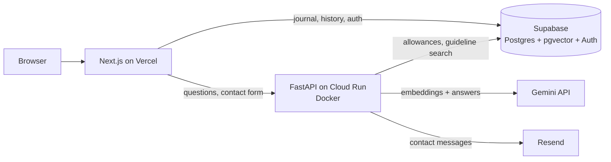

# Ask Orchid

A warm, private companion for people living with PCOS. Ask questions and get plain-language answers grounded in the international PCOS guideline, keep a daily journal of moods, periods and symptoms, and see the patterns in your own pages.

**Live:** [ask-orchid.vercel.app](https://ask-orchid.vercel.app)

> Ask Orchid shares general information, not medical advice. It's built to help people understand their bodies and prepare for conversations with their healthcare provider.

---

## What it does

- **Ask:** questions answered by a retrieval-augmented generation (RAG) pipeline over the 2023 International Evidence-based Guideline for PCOS. Answers are structured, cited and written to be calm rather than clinical.
- **Journal:** one private page per day, with mood, period flow and symptom tags. Saves explicitly, and auto-saves when you turn the page.
- **Insights:** a mood calendar, weekly mood trend with daily ranges, symptom frequency, streaks, and a cycle history that highlights cycles outside the typical 21 to 35 day range.
- **Resources:** short plain-language reads based on the guideline, plus links to trusted sources.

## Architecture



- **Frontend:** Next.js (App Router), TypeScript, Tailwind CSS. Deployed on Vercel.
- **Backend:** FastAPI in a Docker container on Google Cloud Run (Toronto region). It's the only part that holds AI and service-role keys.
- **Data:** Supabase for Postgres, authentication and pgvector. Every user-facing table is protected by row level security.
- **AI:** Gemini embeddings for retrieval and Gemini for generation, in JSON mode.

## How a question is answered

1. The backend checks the asker's daily allowance (3 a day for guests, 15 for signed-in users).
2. The question is embedded and matched against about 1,100 guideline chunks with a pgvector similarity search.
3. If nothing relevant is found, Orchid says so without calling the model at all.
4. Otherwise, Gemini answers using only the retrieved passages, returning structured JSON: a summary, a few points, and a gentle closing.
5. If the model is unavailable, the user gets a friendly message and their question isn't counted.

## Design decisions

**Privacy first, because this is health data**
- Journal entries and question history are readable only by their owner, enforced in the database with row level security, not just in the UI.
- Insights loads only tags (date, mood, flow, symptoms), never journal text.
- Guests are counted with a salted one-way hash of their IP address, so no real IP is stored.
- Shared caching of user questions was considered and rejected, so one person's question can never surface in another's answer.

**Keeping a free app affordable**
- Daily allowances per user and per guest, stored in Postgres so they survive restarts and are shared across instances, checked and incremented atomically.
- A per-minute rate limit for spam, plus a hard monthly spend cap on the model.
- A mock mode (`MOCK_LLM`) so all frontend work runs without model calls.
- Repeated questions are answered from the user's own history with no API call.

**One design system**
- All colors, fonts and the type scale are Tailwind design tokens defined once in `globals.css`.
- Styling is Tailwind classes only. Inline styles are used only for values computed at runtime, like bar widths.
- Shared UI primitives (`Button`, `TextField`, `PillScroll`, `PageLabel`) instead of repeated styles.
- Logic lives in `lib/` and UI in `components/`, so the logic can be reused by a future mobile app.

**Responsive by layout, not by shrinking**
- The illustrated cork board and clipboard layouts are used from 1024px up. Below that, the same pieces switch to stacked, content-sized layouts, including a chat view for Ask.

## Project structure

```
pcos-journal/
  backend/
    main.py              API routes, rate limits, errors
    retrieval.py         embedding, guideline search, generation
    allowance.py         daily question allowances
    supabase_client.py   shared database client
    mock.py              sample answer for development
    Dockerfile
  frontend/
    app/                 pages (App Router)
    components/
      ui/                shared primitives
      layout/            navbar, footer, logo
      ask/ journal/ insights/ resources/ landing/ auth/
    lib/                 data access and pure logic (insights maths, dates, API calls)
    hooks/
```

## Running locally

**Backend**
```bash
cd backend
python -m venv venv
source venv/bin/activate
pip install -r requirements.txt
uvicorn main:app --reload
```

**Frontend**
```bash
cd frontend
npm install
npm run dev
```

Set `MOCK_LLM=true` in `backend/.env` to develop without calling Gemini.

## Environment variables

Values are never committed. Locally they live in `backend/.env` and `frontend/.env.local`.

**Backend**

| Variable | Purpose |
|---|---|
| `GEMINI_API_KEY` | Gemini embeddings and generation |
| `SUPABASE_URL` | Supabase project URL |
| `SUPABASE_SERVICE_KEY` | Service role key (backend only) |
| `MOCK_LLM` | `true` returns a sample answer instead of calling Gemini |
| `ASK_RATE_LIMIT` | Short-term limit per IP, e.g. `5/minute` |
| `GUEST_DAILY_LIMIT`, `USER_DAILY_LIMIT` | Daily question allowances |
| `USAGE_SALT` | Secret salt for hashing guest IPs |
| `ALLOWED_ORIGINS` | Comma-separated sites allowed to call the API |
| `RESEND_API_KEY`, `CONTACT_TO_EMAIL` | Contact form delivery |
| `CONTACT_RATE_LIMIT` | Contact form limit per IP, e.g. `3/hour` |

**Frontend**

| Variable | Purpose |
|---|---|
| `NEXT_PUBLIC_SUPABASE_URL` | Supabase project URL |
| `NEXT_PUBLIC_SUPABASE_ANON_KEY` | Public anon key |
| `NEXT_PUBLIC_API_URL` | Backend URL |

## Deployment

- **Frontend:** Vercel, with the root directory set to `frontend/`.
- **Backend:** Docker image on Google Cloud Run, running as a non-root user with proxy headers enabled so rate limits see real client IPs. Instances are capped to keep costs predictable.

## Roadmap

- CI/CD with GitHub Actions, and secrets moved to Google Secret Manager
- RAG evaluation against a set of 50 guideline-referenced questions
- More guidelines (Endocrine Society, SOGC) in the knowledge base
- Account deletion from inside the app
- A mobile app (Expo + NativeWind) reusing the shared logic

## Content

Health content is based on the [2023 International Evidence-based Guideline for the Assessment and Management of PCOS](https://www.monash.edu/medicine/mchri/pcos/guideline). In May 2026 the condition was renamed polyendocrine metabolic ovarian syndrome (PMOS). Ask Orchid uses "PCOS" for now, since the new name is being phased in.

---

Built by [Suha Qazi](https://www.linkedin.com/in/suha-qazi).